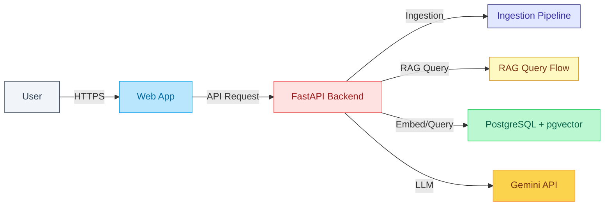
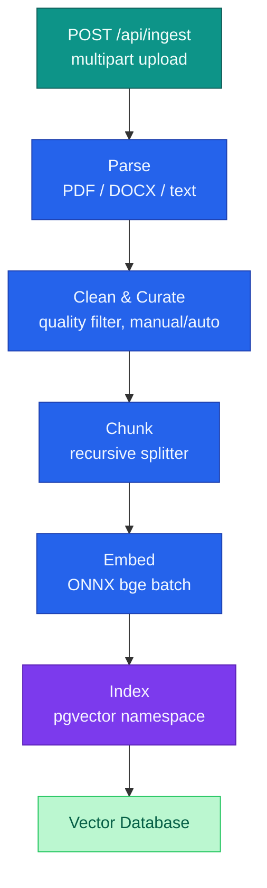
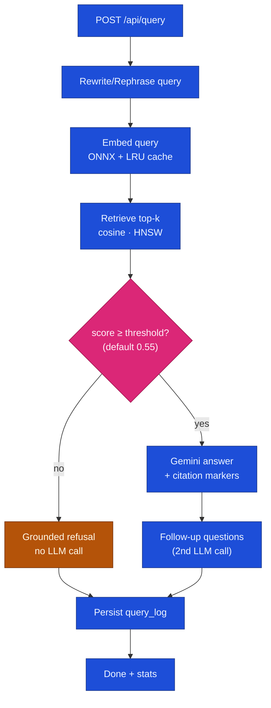

# Enterprise Knowledge Platform

## AIM

### **Document Intelligence and Knowledge Querying**:

Upload your documents (or use demo corpus), ask natural questions, and get cited answers from your own content. 

### **Transformation Flow** :

Parse and transform documets into sementaically searchable knowledge base.

### **RAG AI Agent** :

Analyse user's query, Search relevant knowledge from vector Database and Generate qualitative answer with follow up questions.

---

## Backend architecture & tech-stack

### Stack at a glance


| Layer          | Choice                                                                 |
| -------------- | ---------------------------------------------------------------------- |
| **Framework**  | Langchain, Langgraph                                                   |
| **API**        | Python 3.11 · FastAPI · Uvicorn (async SSE)                            |
| **Embeddings** | `BAAI/bge-small-en-v1.5` via ONNX Runtime (int8) on CPU                |
| **Chunking**   | LangChain text splitters                                               |
| **LLM**        | Gemini                                                                 |
| **Database**   | PostgreSQL 16 + **pgvector** (HNSW) — vectors *and* app data in one DB |


### Runtime topology

Everything except the Gemini call stays on the box. nginx terminates TLS and serves the SPA; the API owns ingestion, retrieval, and generation in-process.




### Document ingestion workflow

Upload → validate → consume ingest budget → stream each stage over SSE (`parse → clean → chunk → embed → index`). Chunks keep character offsets so citations can highlight the source later.



### RAG query workflow

Question → consume query budget → embed (LRU-cached) → HNSW retrieve in the link’s namespace → **grounding check**. Below the similarity threshold the API refuses without calling Gemini; otherwise it streams tokens and follow-up suggestions.



## Quick start (production)

```bash
cp .env.example .env        # GEMINI_API_KEY, passwords, JWT_SECRET
make up                     # builds + starts nginx, api, postgres (TLS self-signed)
make seed                   # ingest the default demo corpus
make link LABEL="Acme Corp — RAG bid"   # mint a proposal link to share
```

Open `https://<host>/admin` for the admin portal (credentials from `.env`).

```bash
make down                   # stop nginx, api, postgres (containers kept)
```

## Development

```bash
cp .env.example .env
make dev-install            # backend venv + npm install
make dev                    # postgres (docker) + uvicorn --reload + vite
make dev-seed               # seed default corpus into the dev DB
make dev-link LABEL="Local test"
```

Vite serves on `http://localhost:5173` and proxies `/api` to the local API on port 8000.

`make dev` runs uvicorn and Vite in the foreground — press `Ctrl+C` to stop both, then:

```bash
make dev-down               # stop the postgres container used by `make dev`
```

## Configuration

- `config.yaml` — non-secret tunables (model, chunking, retrieval threshold, warm-up policy, limits). Apply with `make reload`.
- `.env` — secrets only (API key, admin login, JWT secret, DB password).


## Layout

```
backend/          FastAPI app (ingestion pipeline, RAG, links, admin)
frontend/         React + Vite + Tailwind SPA
nginx/            reverse proxy + TLS termination
docs/             feature spec and architecture
config.yaml       system config (versioned)
Makefile          single entry point for dev + prod
```

